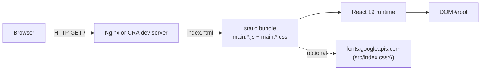
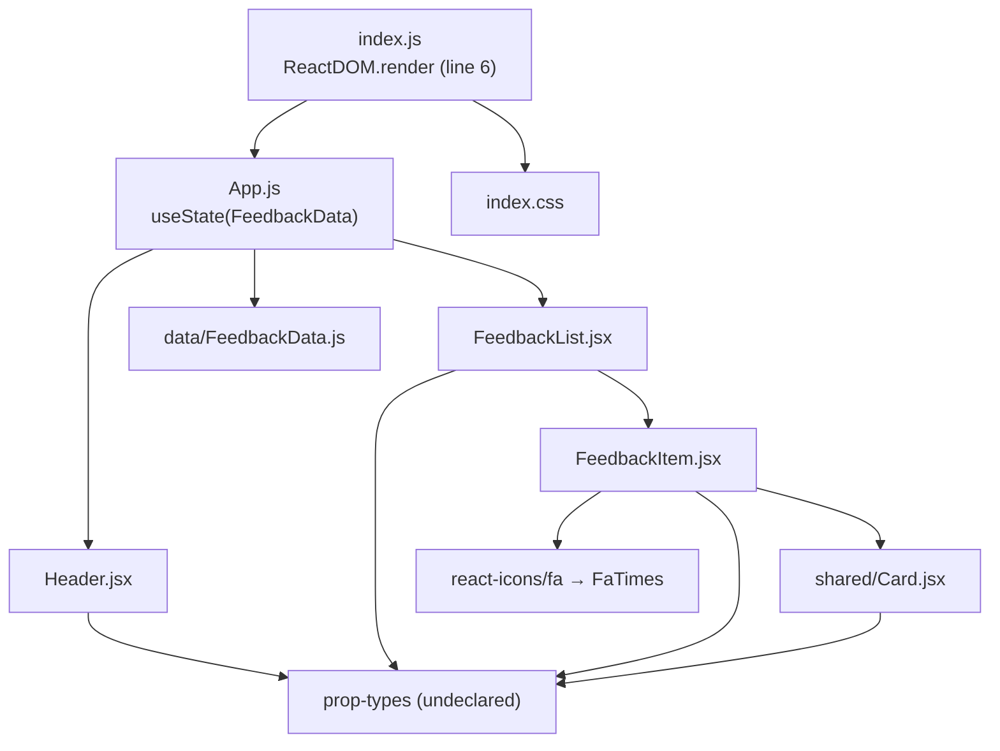
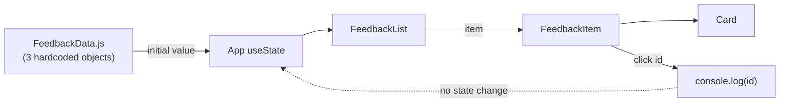
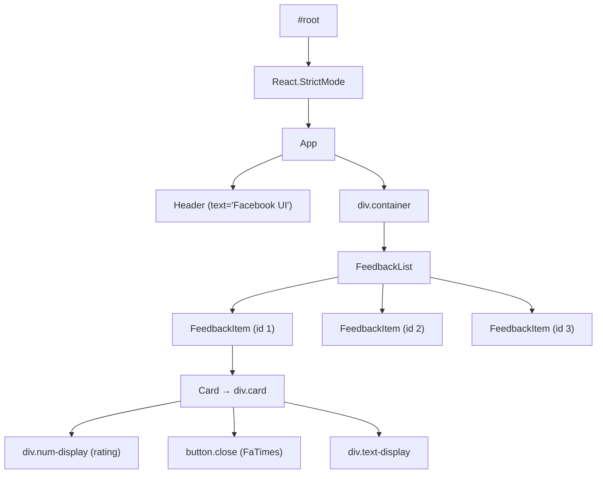
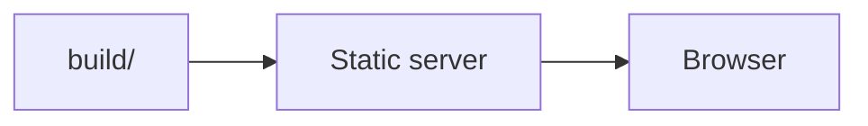

# Architecture — react_beginner

> Status: audit snapshot of `master` @ `aa73be5` (2026-11-13).
> Everything below is derived from the tracked code. Parts that could not be proven from the code are marked **unconfirmed**.

## 1. What the system is

A single-page, client-only React application. There is no server, no database, no queue, and no third-party API. All data is compiled into the bundle. The only executable entry point is `src/index.js`, which mounts `src/App.js` into `#root` from `public/index.html`.

The app is a React tutorial rebuild of `bradtraversy/feedback-app` (credit at `src/index.css:1-3`).

## 2. Runtime topology



No environment variables, no configuration endpoint, no backend call.

## 3. Source layout (actual, 26 tracked files)

```
.
├── public/
│   ├── index.html          # CRA HTML template; <title>Feedback UI</title>
│   ├── manifest.json       # PWA metadata (template values)
│   ├── favicon.ico
│   ├── logo192.png
│   ├── logo512.png
│   └── robots.txt
├── src/
│   ├── index.js            # entry point (ReactDOM.render)
│   ├── index.css           # global stylesheet (197 lines)
│   ├── App.js              # root component + state
│   ├── components/
│   │   ├── Header.jsx
│   │   ├── FeedbackList.jsx
│   │   ├── FeedbackItem.jsx
│   │   └── shared/
│   │       └── Card.jsx
│   └── data/
│       └── FeedbackData.js
├── package.json
├── package-lock.json
├── README.md
├── cmd                     # setup scratch notes
├── .gitignore
├── .idea/                  # tracked IDE files
└── .vscode/settings.json
```

## 4. Module map



Import edges are exactly the ones written in the files: `App.js:1-4`, `FeedbackList.jsx:1-2`, `FeedbackItem.jsx:2-4`, `Card.jsx:1`, `Header.jsx:1`.

## 5. Component responsibilities

| Module | Responsibility | Props / state | Notes |
|---|---|---|---|
| `index.js` | Bootstrap React into `#root` | — | Calls `ReactDOM.render` (removed in React 19) |
| `App.js` | Owns the feedback list in local state; composes page | `useState(FeedbackData)` | `setFeedback` is declared but never used |
| `Header.jsx` | Renders a title bar with configurable colours | `text`, `bgColor`, `textColor` | `defaultProps` are ignored by React 19 |
| `FeedbackList.jsx` | Empty-state guard + list rendering | `feedback: array` | Maps each item to `FeedbackItem` with `key={item.id}` |
| `FeedbackItem.jsx` | Renders one item: rating badge, text, delete icon | `item: object` | Delete handler only `console.log`s the id |
| `Card.jsx` | Presentational wrapper with optional inverted style | `children`, `reverse` | `defaultProps` ignored by React 19 |
| `FeedbackData.js` | Static seed data (3 objects) | — | No fetch, no persistence |

## 6. Data flow



There is no data-fetching layer and no mutation path. The list is immutable after mount. Deleting an item is not implemented.

## 7. Component tree as rendered (intended)



The header defaults come from `Header.defaultProps` (`Header.jsx:17-21`). They are **not applied by React 19**, so in a working build the header would render with no text and no colours — see `REPOSITORY_AUDIT.md` A-03.

## 8. Styling

- Single global stylesheet `src/index.css` (197 lines), imported once in `src/index.js:3`.
- Class names are plain strings; no CSS modules, no CSS-in-JS, no Tailwind, no preprocessor.
- Remote font import: `@import url('https://fonts.googleapis.com/css2?family=Poppins...')` (`src/index.css:6`).
- Responsive rule at `max-width: 600px` (`src/index.css:219-235`).
- Only a subset of the classes is used by the current tree; the rest are leftovers from the tutorial (see `TECHNICAL_DEBT.md` TD-09).

## 9. Build and packaging

| Stage | Tool | Config |
|---|---|---|
| Dev server | `react-scripts start` (webpack-dev-server 4) | `package.json:16` |
| Production build | `react-scripts build` (webpack 5, Babel) | `package.json:17` |
| Tests | `react-scripts test` (Jest 27) | `package.json:18`; **no test files** |
| Eject | `react-scripts eject` | present but must not be used (one-way) |

Browser targets are declared in `package.json:27-38`. No custom webpack/Babel config, no `craco`, no `.env`.

The production build succeeds (`Compiled with warnings`, one ESLint warning: `setFeedback` unused) but the emitted application crashes on load because of `ReactDOM.render` (see §10).

## 10. Actual startup behavior (verified)

`src/index.js`:

```js
import ReactDOM from 'react-dom';
ReactDOM.render(<React.StrictMode><App/></React.StrictMode>, document.getElementById('root'));
```

`react-dom@19.3.0` exports no `render`:

```
typeof render: undefined
typeof hydrate: undefined
typeof createRoot: function
```

Served from a production build in Chrome:

```
TypeError: t.render is not a function
```

The page is blank (`#root` stays empty). This is the single blocking defect of the repo.

## 11. Deployment topology

There is no deployment manifest. The artifact is a static `build/` directory that can be served by any static file server. There is no SPA routing, so no history-API fallback is required.



**Unconfirmed:** production hosting target (none is declared in the repo).

## 12. Data model

No database layer exists: no schema, no relations, no indexes, no constraints, no transactions, no migrations, no backup/recovery. This phase is `n/a` for this repo. The in-memory record shape is:

```
Feedback { id: number, rating: number, text: string }
```

## 13. Cross-cutting concerns

| Concern | State |
|---|---|
| Auth / authorization | none |
| Secrets / configuration | none |
| Logging | `console.log` only (`FeedbackItem.jsx:7`) |
| Error handling | none (no error boundary) |
| Observability | none |
| Accessibility | icon-only button has no accessible name; no labels on interactive elements |
| Internationalization | none |